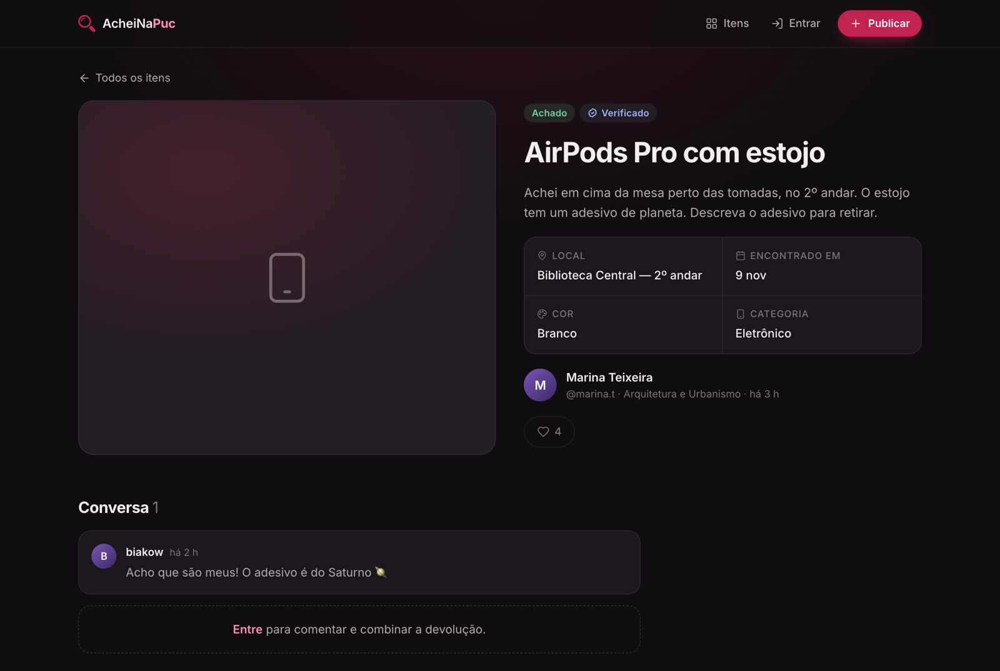

# AcheiNaPuc

**Achados e perdidos da PUCPR.** Quem perdeu algo no campus publica o item; quem encontrou, também. Os dois se acham pelos comentários (públicos ou privados) e combinam a devolução.

**Demo:** [acheinapuc.onrender.com](https://acheinapuc.onrender.com) (pode levar ~40 s para acordar) · contas de teste: `demo` / `demo1234` (estudante) e `moderador` / `modera1234`


## Origem

Projeto da disciplina **Experiência Criativa**, turma 3ºC, PUCPR (2025). Feito em grupo por:

- Gabriel Carmo
- Marcel Neto Araújo Filho
- Igor Thiago Lara da Silva

Em 2026 o projeto passou por uma revisão: correções de segurança, interface nova e deploy público. O modelo de dados e as funcionalidades originais continuam os mesmos; a modelagem do grupo está em [`Documentacao/`](Documentacao).

## O que dá pra fazer

- Publicar um item **perdido** ou **achado**, com local, data, cor, categoria e foto
- Buscar por texto e filtrar por tipo e categoria
- Curtir e comentar; responder comentários, inclusive de forma **privada** (só o autor do item, quem escreveu e os moderadores veem)
- Marcar o próprio item como **devolvido**, reabrir ou remover
- Editar o perfil (foto, nome, usuário) e trocar a senha
- **Moderação:** painel com estatísticas e gráficos, verificação de publicações (selo azul) e desativação de contas



## Stack

- PHP 8.3, sem framework, com PDO
- SQLite por padrão (o banco é criado e populado na primeira visita); MySQL/MariaDB opcional, como no projeto original
- HTML + CSS próprios, tema escuro/claro automático, responsivo; JavaScript só como melhoria (tudo funciona sem JS)
- Docker (Apache) para rodar e para o deploy

## Rodando localmente

Com Docker:

```bash
docker build -t acheinapuc .
docker run --rm -p 8080:80 acheinapuc
```

Abra http://localhost:8080.

Sem Docker (PHP 8.1+ com `pdo_sqlite`):

```bash
php -S localhost:8080 -t public
```

### Usando MySQL (XAMPP etc.)

```bash
cp .env.example .env        # configure DB_DRIVER=mysql e as credenciais
mysql -u root -p < database/schema.mysql.sql
php database/seed.php
```

Credenciais ficam só no `.env` (fora do Git) ou nas variáveis de ambiente do host.

## Estrutura

```
app/            núcleo (sessão, banco, helpers) e views — fora da raiz web
database/       esquemas SQLite e MySQL + dados de demonstração
public/         raiz web: páginas, admin/, assets/, uploads/
Documentacao/   documento e modelagem originais do grupo
```

## Segurança (o que mudou na revisão)

- Todas as consultas usam *prepared statements*; toda saída é escapada (sem XSS)
- Token CSRF em todo formulário; sair da conta só via POST
- Área de moderação exige login de moderador (antes ficava aberta)
- Senhas de moderador agora com hash; mínimo de 8 caracteres para senhas
- Removida a "redefinição de senha só com o e-mail", que permitia tomar qualquer conta; a troca de senha agora exige a senha atual
- Removido o roteador `include.php?dir=&file=`, que permitia incluir arquivos arbitrários
- Uploads validados pelo conteúdo real (não pela extensão), com nome aleatório e sem execução na pasta `uploads/`
- Cookies de sessão `HttpOnly` + `SameSite`, regeneração de sessão no login, limite de tentativas de login, cabeçalhos CSP

## Demo pública

A demo usa SQLite dentro do container: os dados **voltam ao estado inicial** quando o servidor reinicia. Não publique informações reais.
